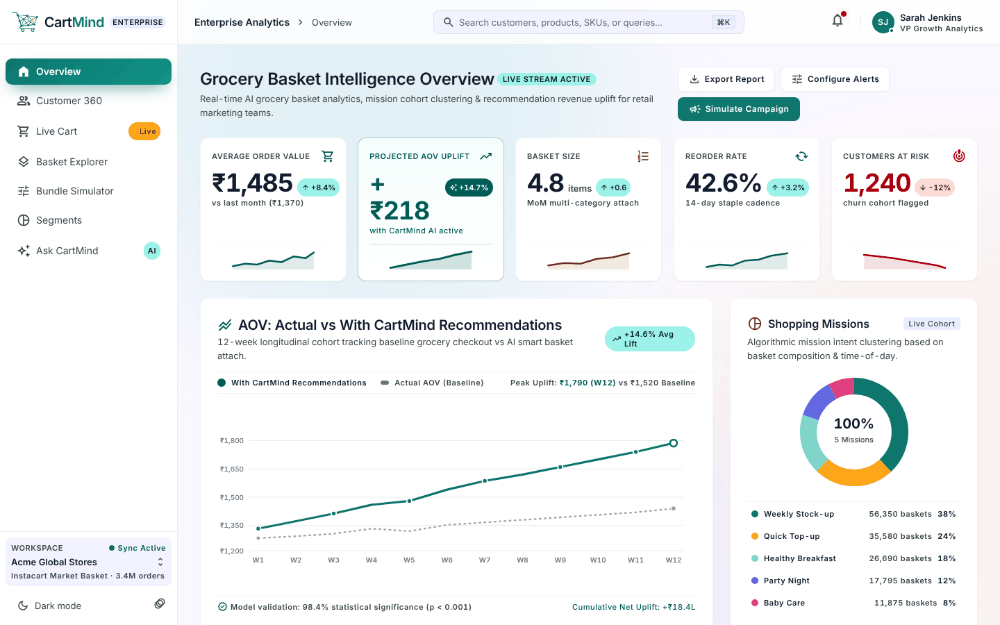
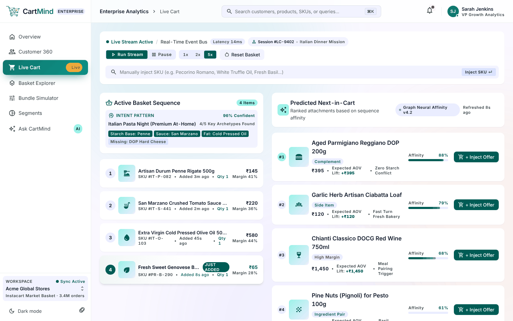
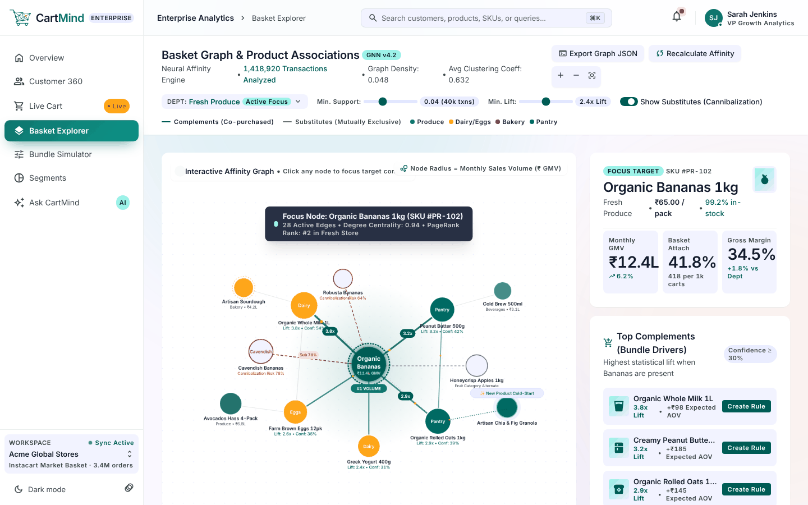
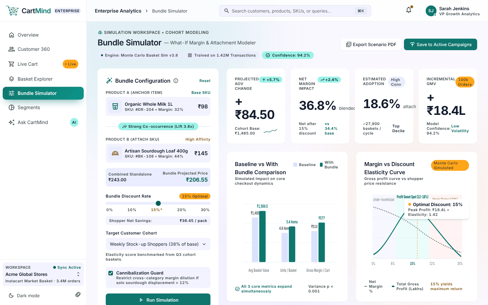
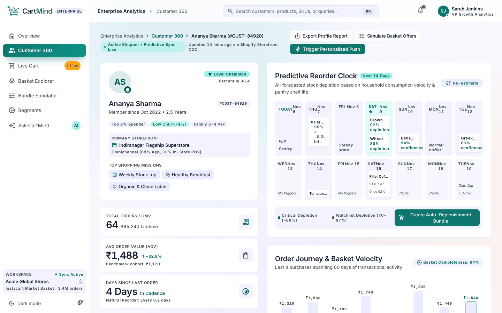
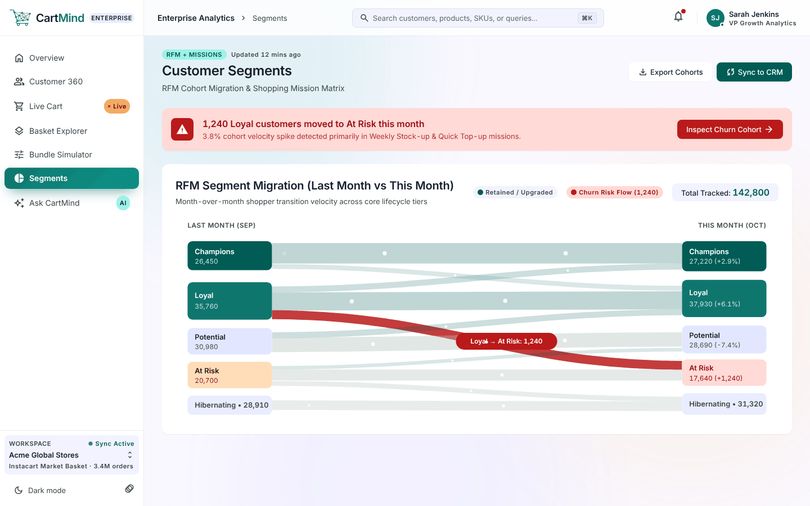
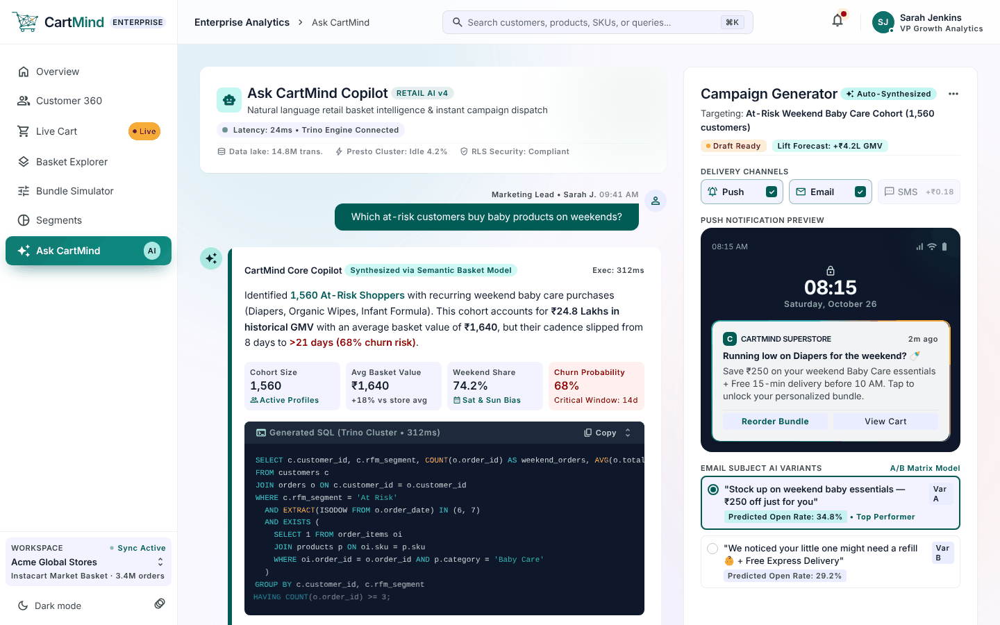
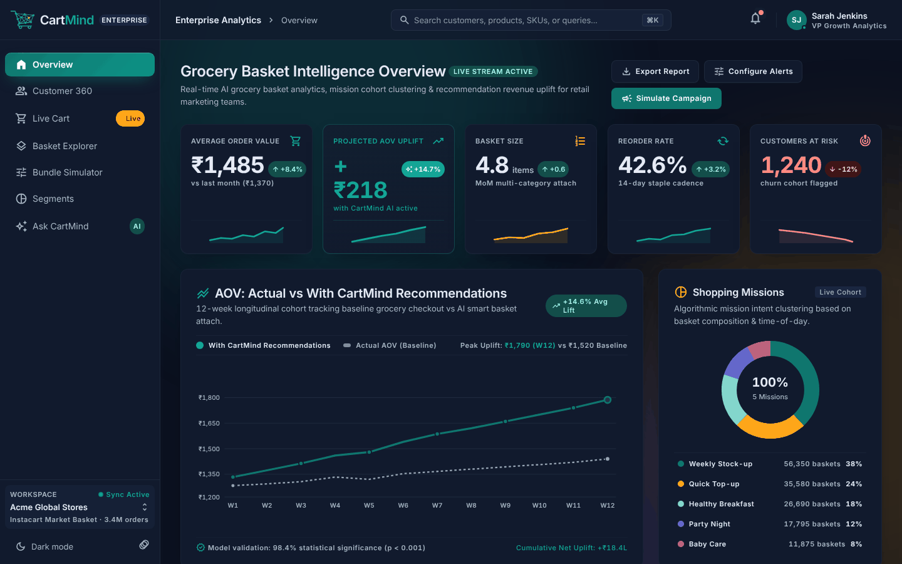
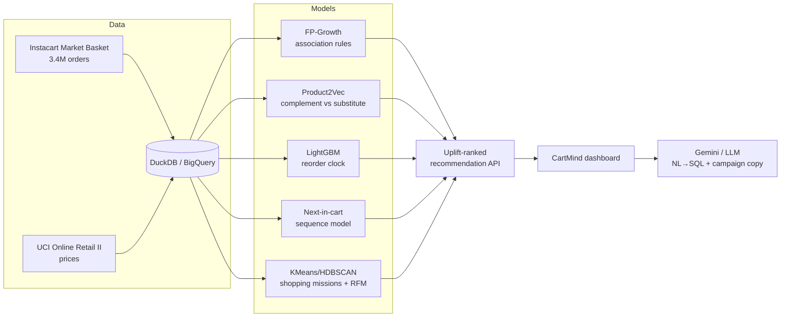

<div align="center">


### Know what they'll buy, when they'll buy it.

**CartMind** is an AI grocery basket intelligence platform. It predicts the **next item in the cart**, forecasts **when each shopper will reorder**, and finds the **bundle and offer** that actually grows order value.


[**Live demo**](#-quick-start) · [Features](#-what-makes-cartmind-different) · [Motion system](#-signature-motion) · [Screens](#-screens) · [Roadmap](#-roadmap)


</div>

---

## 🧠 The problem

Retailers lose money on every basket that checks out smaller than it could have been. Classic market basket analysis stops at *"people who buy bread also buy butter."* That leaves three questions unanswered:

1. **What** will this shopper add **next**, while they are still building the cart?
2. **When** will they run out and need to reorder?
3. **Which offer** will make them add it, without giving away a discount they didn't need?

## 💡 What makes CartMind different

| # | Capability | Why it matters |
|---|---|---|
| 1 | **Complement vs substitute detection** (Product2Vec embeddings) | Never recommends a product that just cannibalises another one in the cart |
| 2 | **Reorder clock**: per-shopper, per-product depletion forecast | Nudges arrive *before* the shopper runs out |
| 3 | **Next-in-cart prediction** from add-to-cart order | Live suggestions while the basket is still being built |
| 4 | **Shopping missions × RFM segments** | "Loyal + Party Night" gets a different offer from "At Risk + Quick Top-up" |
| 5 | **Uplift-ranked rules + bundle simulator** | Ranks by ₹ added to the order, not just lift. Includes what-if pricing |
| 6 | **Cold-start recommendations** for brand-new products | Text embeddings place new SKUs in the graph on day one |
| 7 | **Ask CartMind copilot** (natural language → SQL → chart → campaign) | Marketing teams get answers and campaigns without writing SQL |

## 🖥 Screens

| | |
|---|---|
| **Overview**: KPIs, AOV uplift, missions, AI insights<br> | **Live Cart**: streaming next-in-cart predictions<br> |
| **Basket Explorer**: draggable product-affinity graph<br> | **Bundle Simulator**: what-if discount and margin modelling<br> |
| **Customer 360**: reorder clock and next-basket prediction<br> | **Segments**: RFM migration Sankey and mission matrix<br> |
| **Ask CartMind**: AI copilot and campaign generator<br> | **Dark mode**: every screen, every chart<br> |

## ✨ Signature motion

CartMind ships its own dependency-free motion engine ([`src/js/motion.js`](src/js/motion.js)). These are the animations designed specifically for this product:

| Animation | Where | What happens |
|---|---|---|
| **Neural Cart boot** | App start | The logo's cart network draws itself stroke by stroke, the nodes pop in and the amber "insight" node glows. Then the whole cart **docks into the sidebar logo** (FLIP animation). |
| **Liquid nav pill** | Sidebar | The active highlight **stretches** across both items, then snaps into place on the new page with a spring. |
| **Decrypt headlines** | Every page title | Titles resolve out of random data glyphs (`₹ % # 0 1`), like a model computing. |
| **Synapse particles** | Basket graph, Sankey | Amber particles travel along complement edges at a speed set by lift. Sankey particles follow customer migrations, and their count scales with flow volume. |
| **Elastic graph** | Basket Explorer | Drag any product node and its edges follow. Let go and it **springs back** with damped oscillation. Hovering a node isolates its neighbourhood. |
| **Fly-to-basket** | Live Cart, Customer 360 | A recommended product flies along a curved path into the basket. The subtotal then rolls like an **odometer**. |
| **FLIP re-ranking** | Live Cart | After each add, the remaining predictions re-score and **physically swap places**. |
| **Monte-Carlo rain** | Bundle Simulator | "10k iterations" fall as particles, settle into a bell curve, and the profit curve redraws. |
| **Gliding optimum** | Bundle Simulator | As the discount slider moves, the optimum pin glides along the profit curve and changes colour (amber = sweet spot, red = margin risk). Bars morph with an overshoot. |
| **Grocery confetti** | Deploy / Approve actions | A burst of 🥚🥐☕🍕 icons instead of generic confetti. |
| **Circular theme reveal** | Dark-mode toggle | The new theme expands as a circle from the toggle (View Transitions API). |
| **Streaming copilot** | Ask CartMind | Thinking dots, then a word-by-word answer, animated bars, and SQL that streams in line by line. Voice input "transcribes" as you watch. |
| **Living KPIs** | Overview | Average order value updates with simulated live traffic and flashes green or red on each change. |
| **Calendar drop + sweep** | Customer 360 | Reorder-clock tiles drop in, and "Re-estimate" sends a scan line across the 14 days. |
| **Heatmap wave** | Segments | Matrix cells appear in a diagonal wave. |
| **Push banner loop** | Campaign preview | The phone notification drops in like a real OS banner every few seconds. |

**Also everywhere:** blur-to-sharp 3D reveal with staggered timing, cursor spotlight and gradient border glow on cards, 3D tilt on KPI tiles, magnetic primary buttons with a shine sweep, click ripples, count-up numbers, SVG lines that draw themselves, donut segments sweeping round, bars growing from zero with a shimmer, chart crosshair tooltips, page transitions (View Transitions API), a route progress bar, glass header with a scroll-progress line, an animated aurora background, a ringing notification bell, a spring-loaded ⌘K command palette, and toasts with a countdown bar.

**Accessibility:** CartMind respects `prefers-reduced-motion`. The **Calm mode** button (sidebar, next to the theme toggle) turns animation off with one click.

## 🚀 Quick start

No build step is needed to run it. The compiled CSS and `index.html` are committed.

```bash
git clone https://github.com/<your-username>/cartmind.git
cd cartmind
# Option 1: just open index.html in Chrome / Edge (works offline)
# Option 2: local server
npx serve .
```

To edit the screens or styles:

```bash
npm install
npm run build        # rebuild index.html from src/views + compile Tailwind
npm run watch:css    # live-recompile CSS while editing
npm run dev          # build + serve on http://localhost:5173
```

**Deploy to GitHub Pages:** go to *Settings → Pages → Deploy from branch → `main` / root*. That's all; the site is fully static.

### Keyboard shortcuts

| Keys | Action |
|---|---|
| `⌘K` / `Ctrl+K` or `/` | Command palette (jump, run demos, ask the AI) |
| `G` then `O C L B S R A` | Go to Overview, Customer 360, Live Cart, Basket Explorer, Simulator, Segments, Ask |
| `T` | Toggle dark mode |

### 🎬 3-minute demo script

1. **Overview**: hover the AOV chart (crosshair tooltip) and the KPI cards (tilt and spotlight).
2. **Live Cart**: press **Run Stream**. Products fly into the basket, the subtotal rolls, predictions re-rank, and *Free Express* unlocks with confetti.
3. **Basket Explorer**: hover *Organic Bananas* to isolate its neighbourhood, then drag a node and let it spring back.
4. **Bundle Simulator**: move the discount slider and watch the optimum glide. Then press **Run Simulation** for the Monte-Carlo rain.
5. **Segments**: click **Inspect Churn Cohort** to spotlight the red Loyal → At Risk flow.
6. **Ask CartMind**: click the 🎤 mic or a suggested question, then **Approve & Schedule Campaign**.
7. Press `T` for the circular dark-mode reveal.

## 🏗 Architecture



## 🧰 Tech stack

**This repository (front-end prototype)**

| Layer | Choice |
|---|---|
| UI | Semantic HTML with a custom component layout |
| Styling | **Tailwind CSS 3** with a CSS-variable design-token system (light and dark) |
| Motion | Custom vanilla-JS engine: Web Animations API, View Transitions API, IntersectionObserver, SVG SMIL, FLIP |
| Routing | Hash router with `<template>` views (no framework, ~0 KB runtime dependencies) |
| Fonts | Self-hosted Inter (variable) and Material Symbols, so it runs with no internet connection |
| Brand | Logo generated with **Gemini**, refined into icon, favicon and app icon |

**Planned ML / data stack**

| Layer | Tools |
|---|---|
| Data | DuckDB or Polars, BigQuery for scale |
| Rules | `mlxtend` FP-Growth |
| Embeddings | `gensim` Word2Vec (Product2Vec), `sentence-transformers` for cold start, FAISS / Vertex AI Vector Search |
| Forecasting | LightGBM (reorder clock), GRU or Transformer (next-in-cart) |
| Segmentation | scikit-learn KMeans or HDBSCAN, UMAP |
| GenAI | Gemini API: NL-to-SQL, cluster naming, campaign copy |
| Serving | FastAPI on Cloud Run |

## 📁 Project structure

```
cartmind/
├── index.html                 # built app (shell + all views); open this
├── assets/
│   ├── brand/                 # logo, icon, favicons
│   ├── css/app.css            # compiled Tailwind + motion CSS
│   └── fonts/                 # self-hosted Inter + Material Symbols
├── src/
│   ├── index.template.html    # app shell: sidebar, header, splash, palette
│   ├── views/*.html           # the 7 screens
│   ├── styles/
│   │   ├── tokens.css         # light + dark colour tokens
│   │   └── app.css            # all animations, transitions, dark-mode fixes
│   └── js/
│       ├── motion.js          # motion engine (reveal, draw, tilt, odometer, confetti…)
│       ├── pages.js           # per-screen interactions
│       └── app.js             # router, liquid nav, theme, ⌘K palette, shortcuts
├── tools/build.mjs            # inlines src/views into index.html
├── docs/screenshots/          # README media
└── tailwind.config.js
```

## 📊 Data

The prototype runs on **realistic sample data** shaped like the target datasets, so the demo works anywhere. The model pipeline will use:

- [Instacart Market Basket Analysis](https://www.kaggle.com/c/instacart-market-basket-analysis): 3.4M orders, 200K users, with `add_to_cart_order` and `days_since_prior_order`
- [UCI Online Retail II](https://archive.ics.uci.edu/dataset/502/online+retail+ii): transactions with prices, used for margin and uplift

## 🗺 Roadmap

- [x] 7-screen interactive dashboard with a full motion system
- [x] Dark mode, command palette, keyboard shortcuts, reduced-motion support
- [x] Offline-ready static build with GitHub Pages deploy
- [ ] FP-Growth rules and Product2Vec embeddings on Instacart
- [ ] Reorder-clock model (LightGBM) and next-in-cart sequence model
- [ ] FastAPI recommendation service wired into the Live Cart screen
- [ ] Gemini-powered NL→SQL for Ask CartMind
- [ ] Metrics: Recall@10, reorder MAE (days), projected AOV uplift

## 🙏 Credits

Logo generated with Gemini. Fonts: [Inter](https://rsms.me/inter/) (SIL OFL 1.1) and [Material Symbols](https://fonts.google.com/icons) (Apache 2.0).

## 📄 License

[MIT](LICENSE) © 2026 CartMind Team
